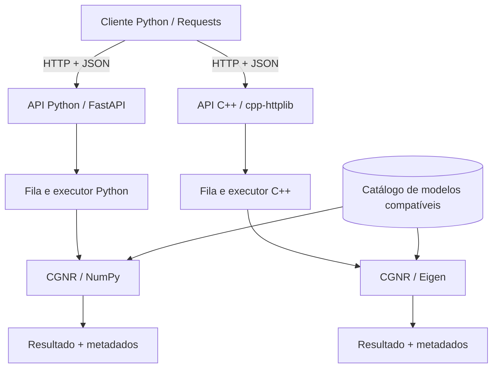
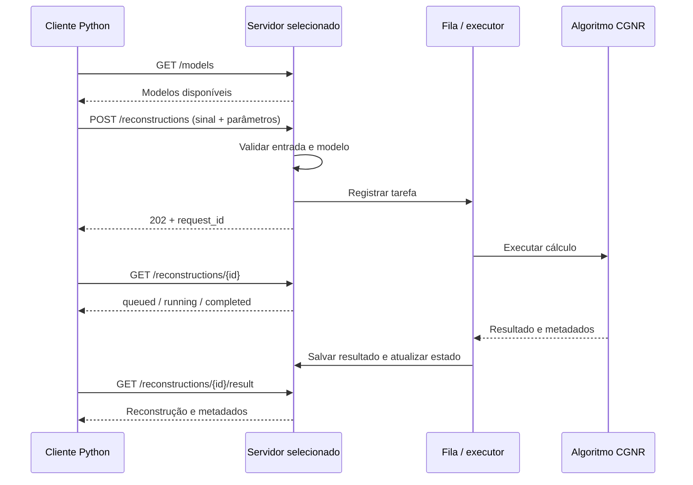

# TASK-02 — Arquitetura cliente-servidor

**Issue:** #2  
**Responsável:** mejuloli  
**Dependência:** TASK-01 — Stack tecnológica e bibliotecas BLAS  
**Status:** Proposta para revisão pelos dois integrantes

## 1. Objetivo

Definir o fluxo de comunicação para solicitar reconstruções de imagens com algoritmos iterativos de álgebra linear. O cliente deve conseguir enviar os mesmos dados e parâmetros a servidores Python e C++, acompanhar a execução e receber resultados comparáveis.

Esta issue **define e documenta a arquitetura**. A implementação da API pertence à **TASK-09**.

## 2. Tecnologias e responsabilidades

A proposta considera as escolhas da TASK-01:

| Componente | Tecnologia | Responsabilidade |
| --- | --- | --- |
| Cliente | Python 3 + Requests | Enviar requisições e consultar resultados |
| Servidor Python | FastAPI + Uvicorn | Expor a API e chamar a implementação numérica Python |
| Cálculo Python | NumPy | Operações matriciais e algoritmo CGNR |
| Servidor C++ | C++17 + cpp-httplib + nlohmann/json | Expor a mesma API em C++ |
| Cálculo C++ | Eigen | Operações matriciais e algoritmo CGNR |
| Aceleração numérica | OpenBLAS | Backend BLAS conforme configuração e verificação da TASK-01 |

**Decisão proposta:** dois servidores independentes, com contrato HTTP/JSON equivalente. O cliente escolhe qual servidor usar pela URL. A arquitetura definitiva precisa ser aprovada por ambos.

## 3. Diagrama da arquitetura



Os servidores executam os mesmos algoritmos sobre modelos e sinais equivalentes, para permitir comparação entre implementações.

## 4. Comunicação e endpoints

- **Protocolo:** HTTP/1.1.
- **Representação:** JSON em UTF-8 (`Content-Type: application/json`).
- **Ambiente inicial:** execução local, com endereços configuráveis (ex.: `http://127.0.0.1:8000` para Python e `http://127.0.0.1:8080` para C++).
- **Modelo de execução:** envio da tarefa e consulta posterior por identificador, sem manter a conexão HTTP aberta durante o cálculo.

| Método | Rota | Ação |
| --- | --- | --- |
| `GET` | `/health` | Verificar se a API responde |
| `GET` | `/models` | Listar os modelos matriciais disponíveis |
| `GET` | `/models/{model_id}` | Consultar metadados de um modelo |
| `POST` | `/reconstructions` | Validar e enfileirar reconstrução |
| `GET` | `/reconstructions/{request_id}` | Consultar o estado da execução |
| `GET` | `/reconstructions/{request_id}/result` | Obter o resultado após conclusão |

### 4.1 Exemplo de requisição

`POST /reconstructions`

```json
{
  "model_id": "model_01",
  "algorithm": "cgnr",
  "signal": [1.2, 0.8, 1.5, 0.4],
  "parameters": {
    "max_iterations": 100,
    "tolerance": 0.000001
  }
}
```

- `model_id`: referência a uma matriz previamente disponibilizada no servidor.
- `signal`: vetor de medições, com comprimento igual ao número de linhas da matriz.
- `max_iterations`: inteiro positivo.
- `tolerance`: número positivo finito.

Os valores são **ilustrativos**, não dados experimentais do projeto.

### 4.2 Resposta de aceitação

Código HTTP: **202 Accepted**.

```json
{
  "request_id": "req_001",
  "status": "queued",
  "status_url": "/reconstructions/req_001"
}
```

O identificador deve ser único no servidor. O cliente deve manter também a URL do servidor que gerou o identificador.

### 4.3 Consulta do estado

`GET /reconstructions/req_001`

```json
{
  "request_id": "req_001",
  "status": "running",
  "model_id": "model_01",
  "algorithm": "cgnr",
  "created_at": "2026-11-12T13:00:00Z",
  "started_at": "2026-11-12T13:00:01Z",
  "finished_at": null
}
```

Estados previstos: `queued`, `running`, `completed` e `failed`.

### 4.4 Consulta do resultado

`GET /reconstructions/req_001/result`

```json
{
  "request_id": "req_001",
  "status": "completed",
  "result": {
    "vector": [0.2, 0.7, 0.4, 0.9],
    "shape": [2, 2]
  },
  "metadata": {
    "model_id": "model_01",
    "algorithm": "cgnr",
    "implementation": "python",
    "iterations": 48,
    "converged": true,
    "stop_reason": "tolerance_reached",
    "residual_norm": 0.00012,
    "execution_time_ms": 35.7
  }
}
```

Os valores são fictícios. O vetor da imagem é serializado **por linhas** (*row-major*), e `shape` indica as dimensões da imagem. Quando a reconstrução ainda não terminou, propõe-se responder `409 Conflict` à consulta de resultado.

## 5. Identificação dos modelos matriciais

O cliente referencia os modelos por `model_id`, sem reenviar a matriz inteira a cada requisição. Ambos os servidores devem carregar modelos matematicamente equivalentes.

Metadados mínimos:

```json
{
  "model_id": "model_01",
  "rows": 4,
  "columns": 4,
  "image_shape": [2, 2],
  "data_type": "float64",
  "version": "1.0",
  "checksum_sha256": "<sha256-do-arquivo-padronizado>"
}
```

A representação física das matrizes (arquivo, disposição e esparsidade) será definida com base nos dados reais. O hash só deve ser comparado entre servidores se ambos utilizarem o mesmo formato canônico de arquivo.

## 6. Gerenciamento das requisições

1. O servidor recebe e valida a requisição.
2. Verifica a existência do modelo e a compatibilidade de dimensões.
3. Gera `request_id`, registra `queued` e devolve `202 Accepted`.
4. Um executor separado do atendimento HTTP retira a tarefa da fila e marca `running`.
5. O algoritmo executa; o servidor guarda resultado e metadados.
6. O estado passa a `completed` ou `failed`.
7. O cliente consulta o estado periodicamente e recupera o resultado quando disponível.

**Escopo inicial proposto:** uma reconstrução numérica ativa por servidor, com fila limitada e parâmetros de capacidade configuráveis. Não é necessário adicionar serviço externo de filas na primeira versão.

Inicialmente, o estado pode ficar em memória e os resultados em arquivos locais. Isso **não garante retomada de tarefas após reiniciar o servidor**; a política de retenção e reinicialização deverá ser acordada antes da implementação.

## 7. Metadados de reconstrução

Cada reconstrução deverá permitir registrar:

| Campo | Finalidade |
| --- | --- |
| `request_id` | Identificar a execução |
| `model_id`, `model_version`, `model_checksum` | Rastrear o modelo |
| `algorithm`, `implementation` | Identificar algoritmo e linguagem |
| `data_type`, `max_iterations`, `tolerance` | Registrar parâmetros numéricos |
| `iterations`, `converged`, `stop_reason` | Registrar o encerramento |
| `residual_norm` | Registrar o resíduo final, com definição padronizada |
| `execution_time_ms` | Medir apenas o tempo do cálculo numérico |
| `created_at`, `started_at`, `finished_at` | Rastrear o tempo de vida da tarefa |
| `status` | Indicar estado da execução |

Horários usarão ISO 8601 em UTC. As duas implementações deverão adotar a **mesma definição de resíduo e o mesmo critério de parada**, a serem alinhados com as tarefas dos algoritmos (TASK-06 e TASK-07).

## 8. Validação e tratamento de erros

Validações mínimas: modelo existente, algoritmo suportado, dimensões compatíveis, limites de iteração, tolerância válida e ausência de `NaN`/infinito no vetor.

Formato de erro proposto:

```json
{
  "error": {
    "code": "INVALID_SIGNAL_DIMENSION",
    "message": "Dimensao do vetor incompativel com o modelo"
  }
}
```

| HTTP | Exemplo de uso |
| --- | --- |
| `200` | Consulta bem-sucedida |
| `202` | Reconstrução aceita |
| `400` | Parâmetros inválidos ou dimensão incorreta |
| `404` | Modelo ou requisição não encontrados |
| `409` | Resultado ainda não disponível |
| `413` | Requisição acima do limite |
| `422` | Estrutura JSON inválida conforme o contrato |
| `500` | Erro interno inesperado |
| `503` | Capacidade temporariamente indisponível |

## 9. Fluxo completo



## 10. Organização proposta do repositório

```text
client/python/
server/python/
server/cpp/
models/
docs/architecture/client-server.md
tests/api/
tests/integration/
```

Esta é uma **proposta**, a alinhar com a TASK-03 (estrutura e ambiente de desenvolvimento).

## 11. Limitações e decisões pendentes

- Confirmar se o projeto terá **dois servidores independentes** ou um servidor com dois módulos numéricos.
- Confirmar o formato e a escala reais dos modelos e sinais; JSON pode ser pouco eficiente para grandes volumes.
- Confirmar o algoritmo exigido (CGNR e eventual CGNE), a inicialização e o critério de parada.
- Definir limites da fila, duração máxima, retenção de resultados e comportamento após reinicialização.
- Manter os servidores em `127.0.0.1` durante testes locais; exposição externa exigiria autenticação, HTTPS e controles adicionais.

## 12. Critério de aceite e responsabilidades

A TASK-02 estará concluída quando o documento for revisado e **aprovado pelos dois integrantes**, cobrindo protocolo, mensagens, identificação dos modelos, gerenciamento de requisições, metadados, diagramas e fluxo.

A **TASK-09** implementará os endpoints e os mecanismos de comunicação descritos aqui. As **TASK-06 e TASK-07** implementarão os algoritmos numéricos e deverão alinhar os parâmetros e critérios de parada.
