# Relatório técnico comparativo — Python e C++

**Projeto:** Desenvolvimento Integrado de Sistemas
**Instituição:** Universidade Tecnológica Federal do Paraná (UTFPR)
**Atividade:** TASK-23 — Elaborar relatório técnico comparativo
**Base experimental:** TASK-19, TASK-21 e TASK-22

## Resumo

Este relatório apresenta a arquitetura, as tecnologias, a implementação
do algoritmo CGNR e a avaliação experimental de um sistema de reconstrução
de imagens com servidores HTTP desenvolvidos em Python e C++.

A comparação principal utiliza 18 execuções reais, com três cargas
distintas e três repetições por linguagem. São analisados tempo total,
tempo médio de reconstrução, consumo de CPU, memória RSS, filas e
quantidade de trabalhos concluídos.

Nos experimentos publicados, o servidor Python apresentou menor tempo
total da carga HTTP, enquanto o C++ apresentou menor tempo médio do
algoritmo CGNR e menor consumo de memória residente.

Essas diferenças são interpretadas considerando o protocolo experimental,
sem presumir que os resultados sejam generalizáveis a outros ambientes.

## 1. Introdução e objetivos

O projeto desenvolve um sistema distribuído de reconstrução de imagens
a partir de sinais numéricos, empregando o método iterativo CGNR
(Conjugate Gradient on the Normal Equations).

Seu objetivo é implementar versões funcionalmente equivalentes em Python
e C++, disponibilizar a reconstrução por uma API HTTP e analisar
quantitativamente o comportamento das implementações.

Os objetivos específicos são permitir a submissão assíncrona de sinais,
controlar o processamento concorrente, monitorar recursos, produzir
evidências experimentais e comparar resultados sob condições definidas.

## 2. Arquitetura desenvolvida

A arquitetura possui um cliente HTTP, dois servidores alternativos de
reconstrução, uma camada de processamento CGNR, uma fila de trabalhos
e componentes de instrumentação e análise.

O cliente envia um sinal associado a um modelo de reconstrução.
O servidor valida a requisição e, havendo capacidade, responde HTTP 202
com um identificador de tarefa. O processamento acontece de modo
assíncrono, e os endpoints permitem consultar o estado e recuperar
a reconstrução concluída.

A fila possui capacidade limitada e trabalhadores configuráveis.
Quando o limite de admissão é alcançado, novas requisições podem
receber HTTP 503 com o código `QUEUE_FULL`, sem descartar tarefas
anteriormente aceitas.

Ambas as implementações fornecem endpoints de saúde, modelos,
reconstruções, fila e métricas.

## 3. Tecnologias e justificativas

| Componente | Tecnologia | Justificativa |
|---|---|---|
| API Python | FastAPI e Uvicorn | Exposição de endpoints e validação de requisições |
| Computação Python | Python e NumPy | Operações numéricas e desenvolvimento de referência |
| API C++ | C++17, cpp-httplib e nlohmann/json | Implementação compilada do serviço HTTP/JSON |
| Computação C++ | Eigen e OpenBLAS | Operações matriciais e álgebra linear |
| Compilação | CMake | Configuração e construção dos executáveis |
| Dependências Python | uv | Instalação reproduzível do ambiente |
| Monitoramento | psutil, JSON e CSV | Registro estruturado das métricas |
| Visualização | Matplotlib | Construção dos gráficos experimentais |
| Testes | pytest e CTest | Validação automatizada das implementações |

A presença de implementações nas duas linguagens permite observar
diferenças entre seus ambientes de execução, bibliotecas e mecanismos
de atendimento HTTP. A linguagem isoladamente não explica todas
as diferenças observadas.

## 4. Fundamentação e implementação do CGNR

O sistema considera o problema de reconstrução a partir de um modelo
linear representado por:

\[
Ax \approx b
\]

em que `A` é a matriz de sistema, `x` representa a imagem desconhecida
e `b` corresponde aos sinais observados.

O CGNR é um método iterativo para problemas de mínimos quadrados
que aplica gradientes conjugados às equações normais:

\[
A^T A x = A^T b
\]

A implementação realiza operações de multiplicação por `A` e sua
transposta, atualizando iterativamente a estimativa da solução.
O processo é limitado por parâmetros de tolerância e número máximo
de iterações, definidos pelo solicitante.

Nos benchmarks da TASK-21, ambas as implementações empregaram até
10 iterações e tolerância de `1e-8`.

O tempo de reconstrução CGNR deve ser distinguido da latência de
comunicação, do tempo de espera em fila e do tempo total da carga HTTP.

## 5. Metodologia experimental

A campanha comparativa da TASK-21 utilizou uma matriz sintética densa
identificada como `task18_dense_512`, com sinais de dimensão 512.

Foram utilizados três clientes simultâneos e três cargas:
15, 30 e 60 sinais por cliente, correspondendo a 45, 90 e
180 requisições em cada execução.

Cada combinação de carga e implementação foi repetida três vezes,
totalizando 18 execuções.

As configurações incluíram dois workers, capacidade de fila 256,
uma thread BLAS por processo e um servidor novo por execução.
A ordem Python/C++ foi alternada entre repetições.

O plano de sinais foi mantido entre as implementações, com
identificadores e conteúdo verificáveis por SHA-256.

Somente execuções sem rejeições, falhas ou trabalhos incompletos
foram consideradas comparáveis. As 18 execuções publicadas
satisfizeram esses critérios.

As medidas publicadas foram obtidas em Linux x86-64, Python 3.12,
oito CPUs lógicas e aproximadamente 19,3 GiB de RAM.

O procedimento e os registros brutos estão disponíveis em
[documentação da TASK-21](../../tests/task-21-comparative-benchmarks.md)
e [evidências da campanha](../../tests/task-21-evidence/comparison.md).

## 6. Métricas experimentais

As métricas incluem tempo total da carga, duração média do CGNR,
CPU média, pico de memória RSS, tamanho médio e máximo da fila,
quantidade de reconstruções concluídas e falhas.

O speedup apresentado segue a convenção da TASK-21:

\[
S = \frac{T_{Python}}{T_{C++}}
\]

Assim, valores superiores a 1 favorecem C++ quanto ao tempo total,
enquanto valores inferiores a 1 favorecem Python nessa métrica.

### 6.1. Tempo total e processamento CGNR

| Sinais | Python (ms) | C++ (ms) | Python/C++ | CGNR Python (ms) | CGNR C++ (ms) |
|---:|---:|---:|---:|---:|---:|
| 45 | 87,00 | 580,00 | 0,150 | 3,739 | 2,774 |
| 90 | 188,00 | 1234,00 | 0,152 | 4,084 | 2,982 |
| 180 | 344,00 | 2530,00 | 0,136 | 3,749 | 2,795 |

As medidas são medianas das três repetições por combinação.
O tempo médio do CGNR representa o tempo de processamento numérico,
enquanto o tempo total reflete a carga atendida pelo sistema HTTP.

### 6.2. CPU, memória e filas

| Sinais | CPU Python (%) | CPU C++ (%) | RSS Python (MiB) | RSS C++ (MiB) | Fila média Python | Fila média C++ |
|---:|---:|---:|---:|---:|---:|---:|
| 45 | 122,71 | 25,49 | 69,38 | 15,12 | 11,61 | 0,00 |
| 90 | 143,67 | 26,51 | 70,59 | 15,82 | 22,40 | 0,00 |
| 180 | 146,72 | 25,63 | 72,95 | 17,25 | 38,49 | 0,00 |

CPU é expressa em porcentagem, com 100% equivalente a um núcleo lógico;
o consumo de processos descendentes também é considerado. O RSS é a
memória residente agregada de processo e descendentes.

A fila média é ponderada temporalmente. Os resultados não devem
ser interpretados como medições de CPU e memória em janelas
de observação necessariamente equivalentes.

## 7. Gráficos comparativos

Os gráficos foram gerados a partir dos arquivos reais `summary.json`,
`samples.csv` e `reconstructions.csv` da TASK-21, utilizando
`monitoring.plots`, desenvolvido na TASK-22.

Cada grupo de gráficos utiliza seis ensaios: três repetições do Python
e três do C++ para a mesma carga.

### Carga de 45 sinais

**Utilização de CPU — 45 sinais**

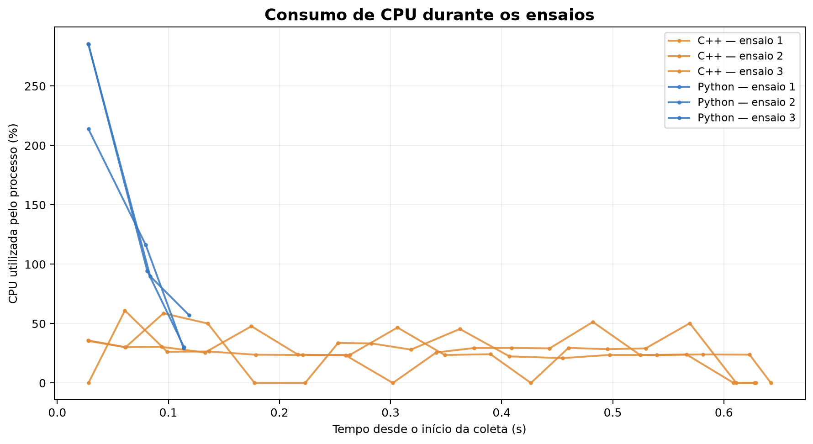

**Memória residente RSS — 45 sinais**

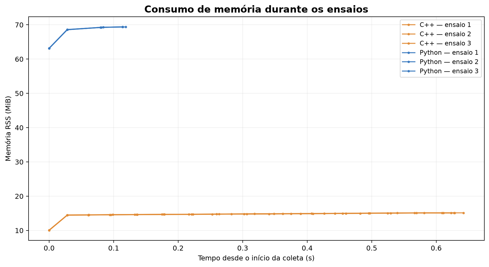

**Tempo total de execução — 45 sinais**

**Tempo médio por reconstrução — 45 sinais**

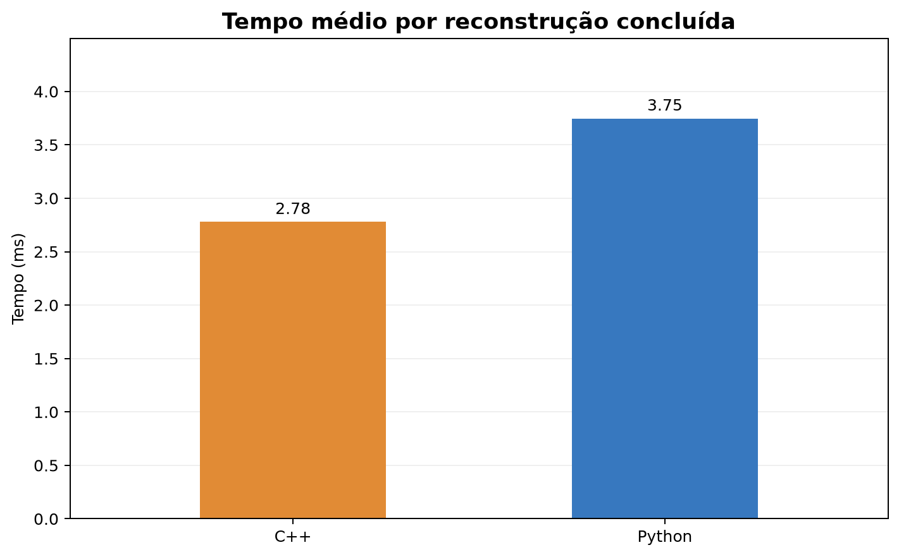

**Reconstruções concluídas e falhas — 45 sinais**

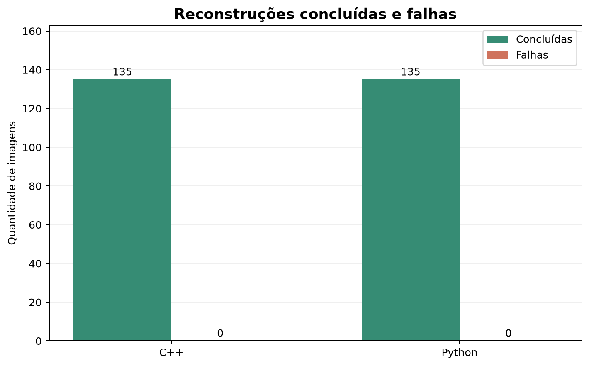

### Carga de 90 sinais

**Utilização de CPU — 90 sinais**

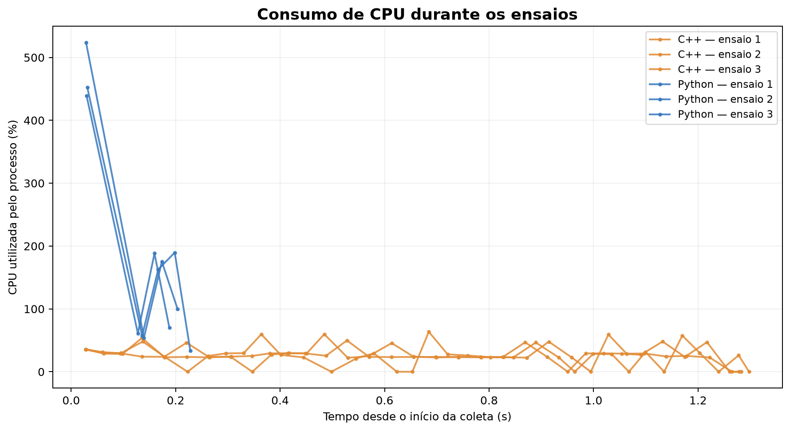

**Memória residente RSS — 90 sinais**

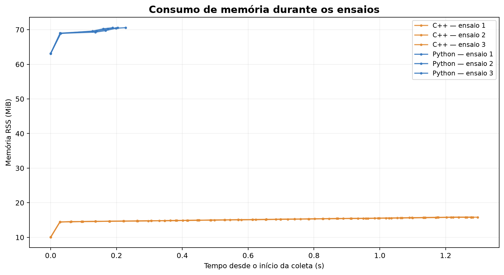

**Tempo total de execução — 90 sinais**

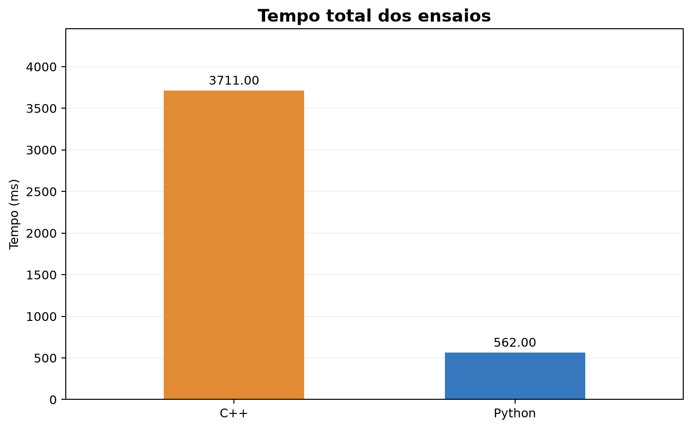

**Tempo médio por reconstrução — 90 sinais**

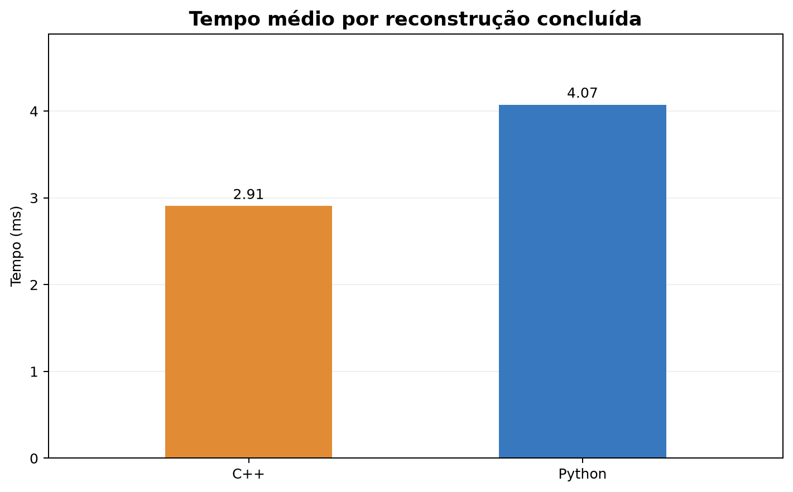

**Reconstruções concluídas e falhas — 90 sinais**

### Carga de 180 sinais

**Utilização de CPU — 180 sinais**

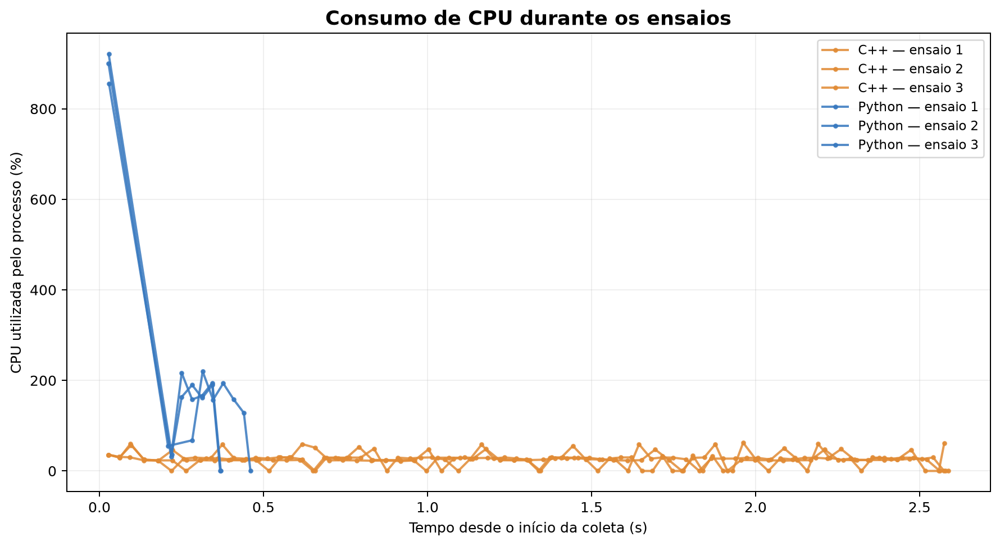

**Memória residente RSS — 180 sinais**

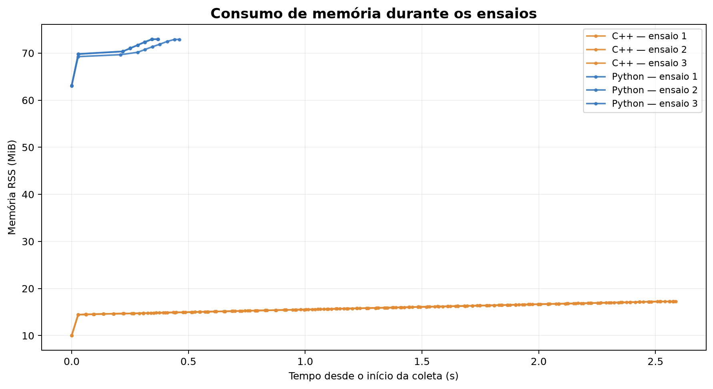

**Tempo total de execução — 180 sinais**

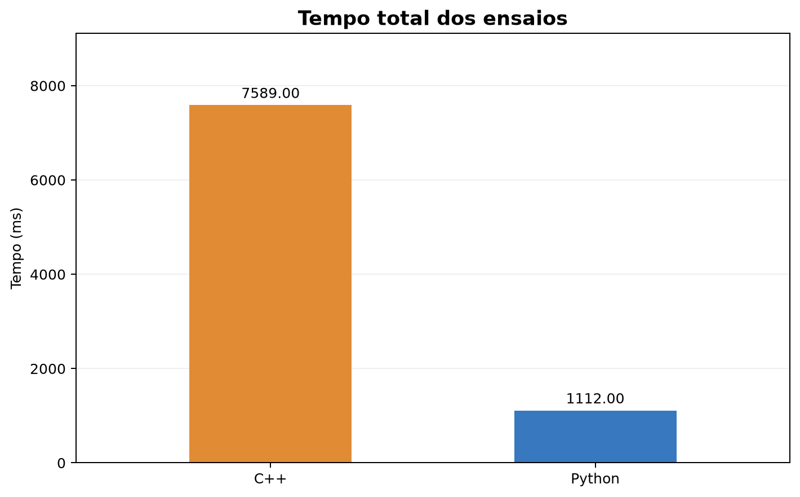

**Tempo médio por reconstrução — 180 sinais**

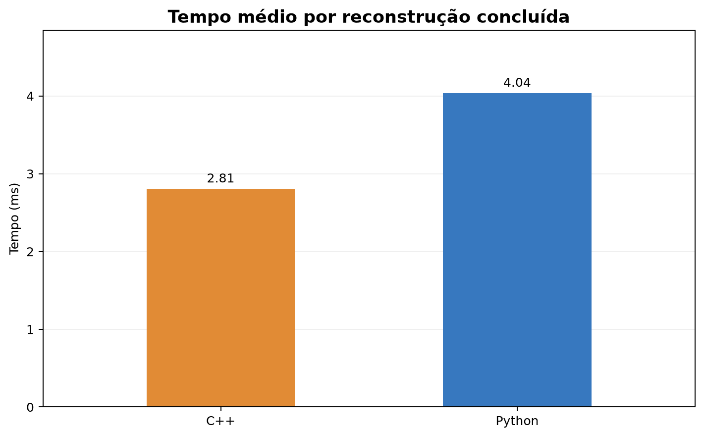

**Reconstruções concluídas e falhas — 180 sinais**

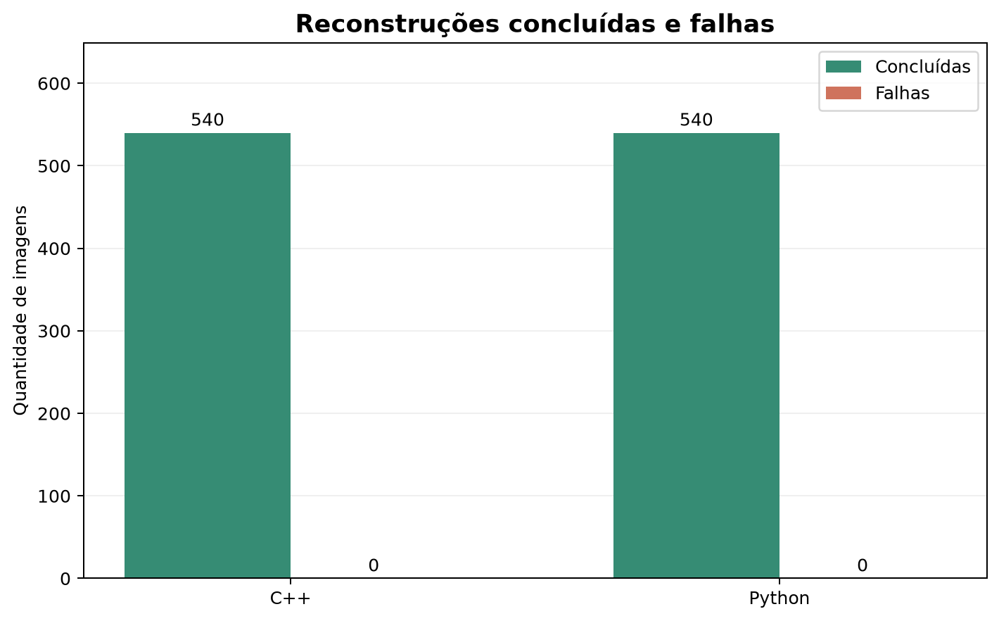

Os arquivos `plots_manifest.json` de cada carga documentam as fontes
e as estatísticas utilizadas na geração das figuras.

## 8. Análise e discussão dos resultados

As medianas de tempo total demonstram vantagem do servidor Python
nas três cargas publicadas. Para 45 sinais, os tempos foram 87 ms
e 580 ms para Python e C++, respectivamente. Para 90 sinais,
188 ms e 1.234 ms. Para 180 sinais, 344 ms e 2.530 ms.

Por outro lado, os tempos médios de reconstrução CGNR do C++
foram inferiores aos do Python nas três cargas.

Isso indica que o tempo total da carga não pode ser empregado como
medida exclusiva da velocidade do algoritmo numérico.

Os registros de requisições mostram, em parte dos ensaios C++,
latências HTTP recorrentes próximas de 43 ms após o primeiro POST.
O protocolo mantém três clientes concorrentes, porém cada cliente
aguarda a resposta ao POST antes do próximo envio.

Esse padrão pode estar associado à comunicação e ao gerenciamento
de conexões, mas os registros não isolam uma causa específica.

Nos mesmos ensaios, o C++ apresentou menor uso de memória RSS e
menor ocupação média da fila. Já o Python apresentou maior utilização
de CPU durante janelas de execução mais curtas.

### 8.1. Complemento: controle de saturação da TASK-19

A TASK-19 avaliou 24 execuções em uma campanha diferente,
comparando configurações antes e depois do ajuste de admissão.

O perfil anterior utilizou um worker, fila de capacidade 2 e limite
de três tarefas em voo. O ajustado utilizou dois workers, fila de
capacidade 8 e limite de seis tarefas em voo.

Na configuração ajustada, o C++ aceitou todas as requisições nos
cenários de 45, 90 e 180 tentativas. O Python apresentou melhorias
em vários cenários, mas continuou com rejeições HTTP 503.

Esses experimentos avaliam saturação e admissão, enquanto a TASK-21
avalia desempenho sob cargas integralmente processadas. As duas
campanhas não devem ser misturadas em uma única comparação de tempos.

Os resultados medidos estão em
[evidências da TASK-19](../../tests/results/task-19/comparison.md).

## 9. Limitações e ameaças à validade

As principais limitações incluem:

- A matriz de teste é sintética e densa; resultados podem variar
  com matrizes reais, outras dimensões e características numéricas.
- Os experimentos foram realizados em um ambiente de hardware
  específico e não representam todas as plataformas.
- A quantidade de repetições limita a avaliação de variabilidade.
- A duração das janelas de monitoramento difere entre implementações.
- O protocolo de envio HTTP, a reutilização de conexões e o
  agendamento de threads podem influenciar o tempo total.
- O uso de CPU e memória depende do processo, de seus descendentes
  e das bibliotecas matemáticas utilizadas.
- A TASK-19 altera simultaneamente workers, fila e admissão, de modo
  que não permite atribuir melhorias a apenas um desses parâmetros.
- Não houve isolamento experimental suficiente para atribuir as
  diferenças de latência HTTP a um mecanismo TCP específico.

Portanto, os resultados descrevem o desempenho observado nas condições
testadas e não estabelecem superioridade universal de uma linguagem.

## 10. Conclusão

O projeto implementou um fluxo funcional de reconstrução de imagens
por CGNR em dois servidores HTTP, com processamento assíncrono,
controle de admissão, instrumentação de recursos e geração de evidências.

Os experimentos da TASK-21 mostraram menor tempo total da carga HTTP
no Python, enquanto o C++ apresentou menor tempo médio de CGNR e
menor consumo de memória residente nas configurações avaliadas.

A TASK-19 complementou a análise ao demonstrar o comportamento das
implementações sob saturação e os efeitos conjuntos de ajustes
na política de admissão e concorrência.

Os resultados reforçam a necessidade de avaliar separadamente
desempenho numérico, comportamento do servidor, comunicação HTTP
e consumo de recursos.

Como continuidade, recomenda-se investigar os efeitos de transporte
HTTP/TCP, ampliar a diversidade de matrizes e repetir os ensaios
em diferentes ambientes e cargas.

## Referências e rastreabilidade

- [README — arquitetura e execução](../../../README.md)
- [TASK-19 — controle de saturação](../../tests/task-19-admission-control.md)
- [TASK-19 — resultados medidos](../../tests/results/task-19/comparison.md)
- [TASK-21 — protocolo de benchmarks](../../tests/task-21-comparative-benchmarks.md)
- [TASK-21 — resultados comparativos](../../tests/task-21-evidence/comparison.md)
- [TASK-22 — metodologia dos gráficos](../../tests/task-22-comparative-plots.md)

**Nota de escopo:** este relatório contempla os indicadores documentados nas
TASK-19, TASK-21 e TASK-22. A conformidade com eventuais exigências
adicionais da rubrica do professor deverá ser conferida na TASK-25.
